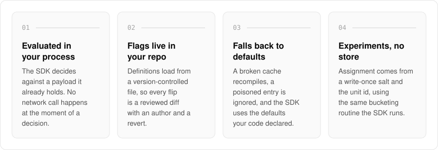
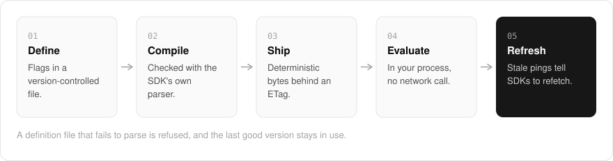

  <picture>
    <source media="(prefers-color-scheme: dark)" srcset=".github/assets/hero-dark.png">
    
  </picture>

<h1 align="center">flag.me.at</h1>

<strong>Feature flags that keep working when this service is down.</strong>

  
  
  

  <a href="#features">Features</a> ·
  <a href="#how-it-works">How it works</a> ·
  <a href="#built-with">Built with</a>

A feature flag service that sits on your request path turns its outage into yours. I built flag.me.at so that cannot happen: rules compile once and ship to your SDK, which evaluates them in your own process, so a flag decision never waits on this service. Definitions live in your repository, where every change has an author and a revert, and experiments run without an assignment store.

> **Status:** in development. The product is not open to visitors yet: an owner-only console and bearer-keyed endpoints are built and tested, and sign-up is not.

  <picture>
    <source media="(prefers-color-scheme: dark)" srcset=".github/assets/overview-dark.svg">
    
  </picture>

## Why flag.me.at

| The usual flag service | flag.me.at |
| --- | --- |
| A network call on the decision path | Evaluated in your process against a payload it already holds |
| Flags flipped in a dashboard | Flags changed by a reviewed diff in your repository |
| An outage can block your requests | Failures fall back to the defaults your code declared |
| An assignment store for experiments | Assignment computed from a write-once salt and the unit id |

## Features

- **Evaluation happens in your process**: the SDK evaluates against a payload it already holds. There is no evaluation RPC, so no network call happens at the moment of a decision.
- **Definitions live in your repository**: flags load from a version-controlled file, so flipping a flag is a reviewed diff. A file that fails to parse is refused and the last good version stays in use.
- **Compiled output the SDK already accepts**: the compiler checks each payload with the SDK's own parser, drops disabled rules, and produces deterministic bytes with an ETag that survives a recompile, so unchanged definitions answer 304.
- **Failures fall back to your defaults**: a broken cache recompiles, a poisoned entry is ignored, and the SDK falls back to the defaults your code declared.
- **Experiments without an assignment store**: assignment is computed from a write-once salt and the unit id with the same bucketing routine the SDK runs. A cautious two-proportion z-test readout stays inconclusive until each arm has enough samples.
- **Flag hygiene**: a debt report finds rules that force one outcome or that nobody has touched, and a scanner records where each key is still referenced (paths and line numbers only, never source).
- **Owner console and rule editor**: create projects, environments and flags, edit targeting rules per environment in evaluation order, mint and revoke environment SDK keys, and review an audit trail that outlives its project.
- **Streamed invalidation alongside polling**: contents-free stale pings tell SDKs when to refetch the bootstrap payload.

## How it works

  <picture>
    <source media="(prefers-color-scheme: dark)" srcset=".github/assets/flow-dark.svg">
    
  </picture>

Flags are defined in a version-controlled file. The compiler checks each payload with the SDK's own parser and emits deterministic bytes behind an ETag, so an unchanged definition answers 304. The SDK evaluates in your process with no network call, and a contents-free stale ping tells it when to refetch.

## Built with

  
  
  
  
  

- Next.js 16 (App Router), React 19, TypeScript
- Tailwind CSS 4
- A companion flag SDK for in-process evaluation
- Drizzle ORM with Postgres, plus a key-value cache for compiled payloads
- Better Auth
- next-intl

## Part of the me.at family

flag.me.at is one of my [`*.me.at`](https://me.at) apps. They share one design system, one account, and one app shell. Development happens in a private monorepo; this repository is the project's public-facing home.

## License

Source-available. See [LICENSE](LICENSE).
