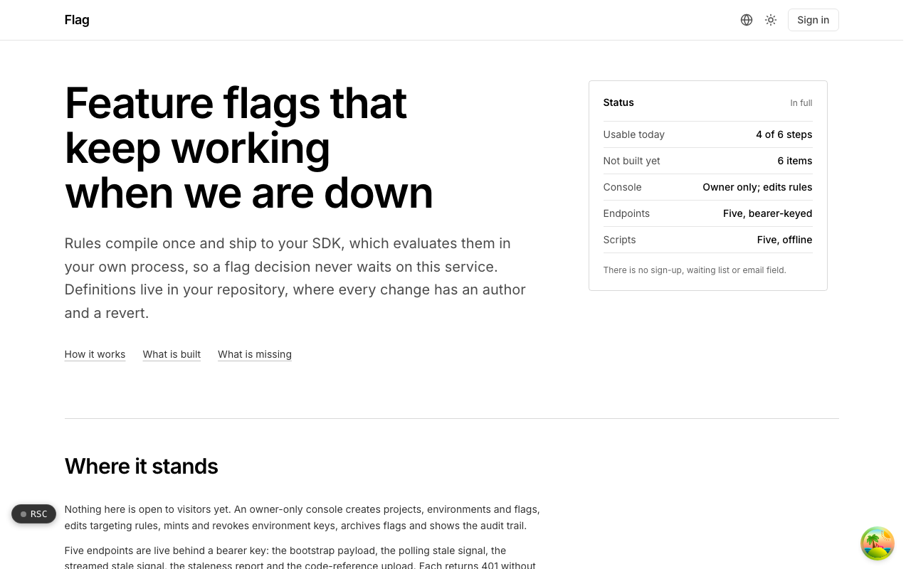

  <picture>
    <source media="(prefers-color-scheme: dark)" srcset=".github/assets/hero-dark.png">
    
  </picture>

# flag.me.at

Feature flags that keep working when we are down.

Flag is feature flags and A/B experimentation with client-local evaluation. Rules compile once and ship to your SDK, which evaluates them in your own process, so a flag decision never waits on this service and an outage can never block your requests. Definitions live in your repository, where every change has an author and a revert. Today the product is not open to visitors: an owner-only console and bearer-keyed endpoints are built and tested, and sign-up is not.

## Features

- **Evaluation happens in your process**: the SDK evaluates against a payload it already holds. There is no evaluation RPC, so no network call happens at the moment of a decision.
- **Definitions live in your repository**: flags load from a version-controlled file, so flipping a flag is a reviewed diff. A file that fails to parse is refused and the last good version stays in use.
- **Compiled output the SDK already accepts**: the compiler checks each payload with the SDK's own parser, drops disabled rules, and produces deterministic bytes with an ETag that survives a recompile, so unchanged definitions answer 304.
- **Failures fall back to your defaults**: a broken cache recompiles, a poisoned entry is ignored, and the SDK falls back to the defaults your code declared.
- **Experiments without an assignment store**: assignment is computed from a write-once salt and the unit id with the same bucketing routine the SDK runs. A cautious two-proportion z-test readout stays inconclusive until each arm has enough samples.
- **Flag hygiene**: a debt report finds rules that force one outcome or that nobody has touched, and a scanner records where each key is still referenced (paths and line numbers only, never source).
- **Owner console and rule editor**: create projects, environments and flags, edit targeting rules per environment in evaluation order, mint and revoke environment SDK keys, and review an audit trail that outlives its project.
- **Streamed invalidation alongside polling**: contents-free stale pings tell SDKs when to refetch the bootstrap payload.

## Built with

- Next.js 16 (App Router), React 19, TypeScript
- Tailwind CSS 4
- A companion flag SDK for in-process evaluation
- Drizzle ORM with Postgres, plus a key-value cache for compiled payloads
- Better Auth
- next-intl

## Part of the me.at family

flag.me.at is one of my [`*.me.at`](https://me.at) apps. They share one design system, account, and app shell. Development happens in a private monorepo; this repository is the project's public-facing home.

## License

See [LICENSE](LICENSE).
